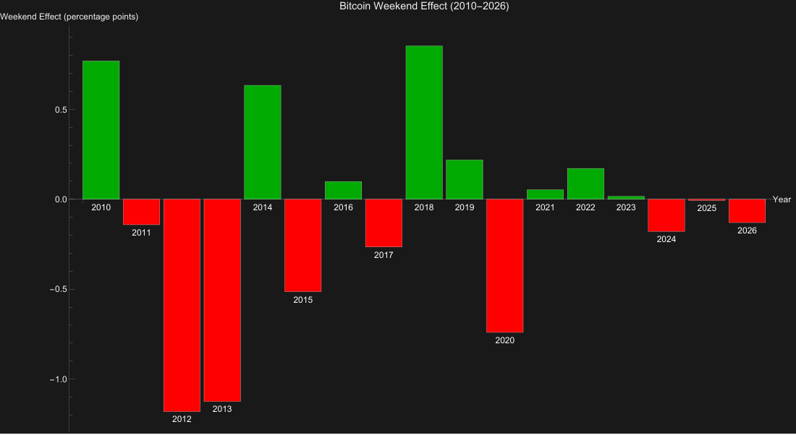
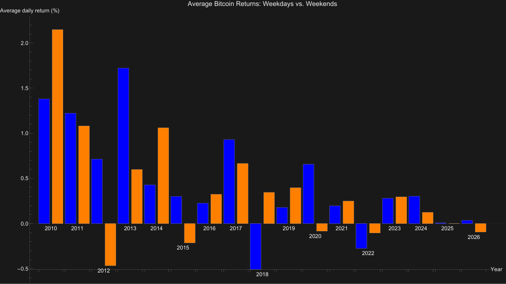
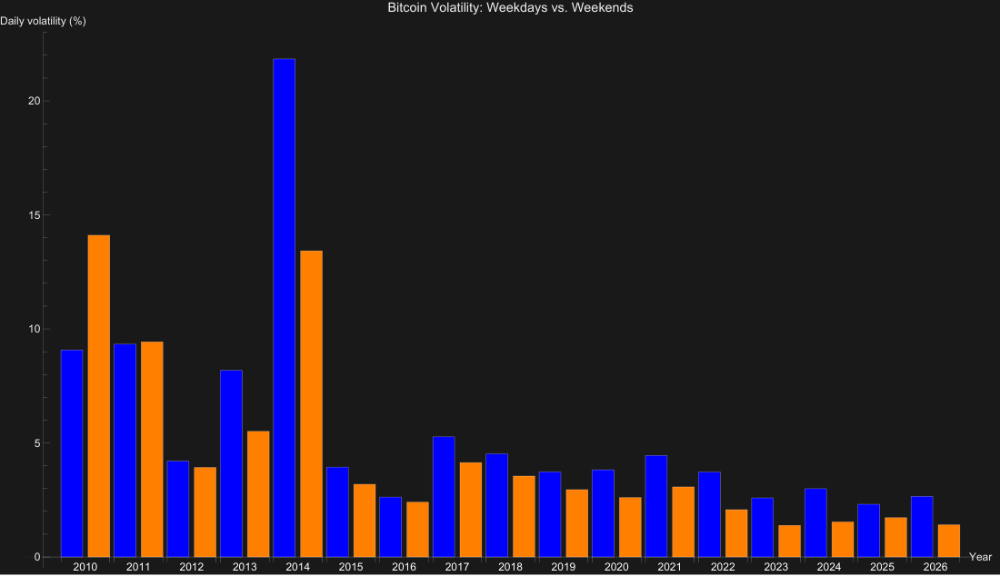
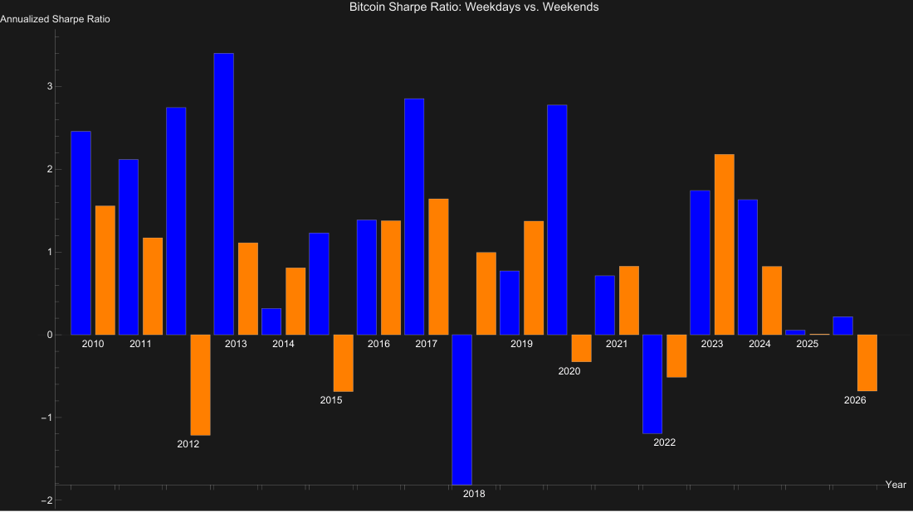

# Bitcoin-Weekend-effect

## 1. Research Question

This project investigates whether daily Bitcoin returns differ
systematically between weekends (Saturday and Sunday) and weekdays
(Monday to Friday).

The analysis focuses on three questions:

-   Are average daily returns higher or lower on weekends?
-   Does return volatility differ between weekends and weekdays?
-   How do returns compare when adjusted for risk, as measured by the
    annualised Sharpe ratio?

The aim is to examine a potential weekend effect using historical price
data. The project does not attempt to predict future Bitcoin prices or
returns.

## 2. Data

The analysis uses the file `data/btc_v_d.csv`, which contains historical
daily Bitcoin prices.

  Attribute                                 Value
  ----------------------------- -----------------
  First recorded trading date        17 July 2010
  Last recorded trading date      25 October 2026
  Price observations imported               5,945
  Daily returns calculated                  5,944
  Data gaps skipped                             0

The CSV file includes, among others, the columns `Date`, `Open`, `High`,
`Low`, `Close` and `Volume`. The program uses only:

-   `Date`: Date of the price observation in `YYYY-MM-DD` format
-   `Close`: Closing price

The data is sorted chronologically. Invalid dates and closing-price
values are skipped during import, and duplicate dates are removed. A
daily return is calculated only when two consecutive records are exactly
one calendar day apart.

## 3. Methodology and Return Classification

Daily returns are calculated from two consecutive closing prices:

``` text
Daily return = (Close_t / Close_(t-1)) - 1
```

Each return is assigned to the weekday of the later date. This produces
two groups:

-   Weekdays: Monday to Friday
-   Weekends: Saturday and Sunday

The overall statistics aggregate all returns across the available
period. The program also calculates the same metrics separately for each
calendar year.

## 4. Overall Results

  Metric                             Weekdays (Mon--Fri)   Weekends (Sat--Sun)
  -------------------------------- --------------------- ---------------------
  Number of returns                                4,245                 1,699
  Average daily return                           0.4328%               0.3173%
  Cumulative return within group         6,013,921.4499%           2,595.6788%
  Daily volatility                               7.2176%               5.4707%
  Annualised volatility                        116.5406%              55.8675%
  Annualised Sharpe ratio                         0.9682                0.5924
  Positive days                                 51.8728%              52.9723%

Difference in average daily returns (weekends minus weekdays): −0.1155
percentage points.

Over the full observation period, average daily returns were higher on
weekdays than on weekends. The annualised Sharpe ratio was also higher
on weekdays (0.9682 compared with 0.5924).

By contrast, measured daily and annualised volatility was lower on
weekends. The proportion of positive days was slightly higher on
weekends.

Cumulative returns are calculated separately for each group. They should
therefore not be interpreted as the actual return of a continuously
investable weekend or weekday strategy.

## 5. Year-by-Year Analysis

The year-by-year analysis examines whether the differences point in the
same direction in individual calendar years.

The difference is defined as:

``` text
Average weekend return − Average weekday return
```

A positive value means that the average daily return was higher on
weekends in the relevant year. A negative value means that the average
daily return was higher on weekdays.

  -----------------------------------------------------------------------------------
  Year       Weekday   Weekend       Avg.       Avg.   Difference   Weekday   Weekend
             returns   returns    weekday    weekend           in    Sharpe    Sharpe
                                   return     return   percentage           
                                                           points           
  -------- --------- --------- ---------- ---------- ------------ --------- ---------
  2010\*         120        47    1.3806%    2.1492%      +0.7686    2.4558    1.5556

  2011           260       105    1.2226%    1.0812%      −0.1413    2.1155    1.1704

  2012           261       105    0.7140%   −0.4664%      −1.1805    2.7439   −1.2138

  2013           261       104    1.7228%    0.5988%      −1.1239    3.3994    1.1101

  2014           261       104    0.4277%    1.0612%      +0.6335    0.3163    0.8073

  2015           261       104    0.2999%   −0.2141%      −0.5140    1.2295   −0.6861

  2016           261       105    0.2255%    0.3240%      +0.0985    1.3856    1.3760

  2017           260       105    0.9303%    0.6654%      −0.2650    2.8514    1.6409

  2018           261       104   −0.5076%    0.3450%      +0.8526   −1.8135    0.9934

  2019           261       104    0.1779%    0.3965%      +0.2185    0.7703    1.3717

  2020           262       104    0.6565%   −0.0836%      −0.7401    2.7743   −0.3276

  2021           261       104    0.1961%    0.2487%      +0.0526    0.7120    0.8267

  2022           260       105   −0.2752%   −0.1042%      +0.1710   −1.1925   −0.5131

  2023           260       105    0.2792%    0.2953%      +0.0161    1.7416    2.1782

  2024           262       104    0.3025%    0.1240%      −0.1785    1.6314    0.8245

  2025           261       104    0.0077%    0.0014%      −0.0063    0.0540    0.0086

  2026\*         212        86    0.0357%   −0.0939%      −0.1296    0.2170   −0.6805
  -----------------------------------------------------------------------------------

2010 and 2026 are incomplete calendar years. The data period begins in
July 2010 and ends on 25 October 2026.


### 5.1 Visual Analysis

The following charts visualise the year-by-year comparison between weekdays
(Monday to Friday) and weekends (Saturday and Sunday). They complement the
annual results table above.

#### Bitcoin Weekend Effect (2010–2026)

The chart shows the difference between average weekend returns and average
weekday returns in percentage points. Positive values indicate higher
average returns on weekends; negative values indicate higher average
returns on weekdays.



#### Average Bitcoin Returns: Weekdays vs. Weekends

The chart compares the average daily Bitcoin returns for weekdays and
weekends in each calendar year.



#### Bitcoin Volatility: Weekdays vs. Weekends

The chart compares daily volatility for weekdays and weekends across the
individual calendar years.



#### Bitcoin Sharpe Ratio: Weekdays vs. Weekends

The chart compares the annualised Sharpe ratios for weekdays and weekends
in each calendar year.



Interpretation of the annual results:

-   In 8 of the 17 reported years, average weekend returns were higher.
-   In 9 of the 17 years, average weekday returns were higher.
-   The direction and magnitude of the difference vary considerably from
    year to year.
-   The Sharpe ratio also shows no consistent pattern across years.

The year-by-year analysis therefore does not show a persistent
difference in favour of weekends.

## 6. Explanation of the Metrics

  -----------------------------------------------------------------------
  Metric                              Meaning
  ----------------------------------- -----------------------------------
  Number of returns                   Number of daily returns included in
                                      the respective group.

  Average daily return                Arithmetic mean of the daily
                                      returns.

  Cumulative return                   Compounding of all returns within
                                      the respective group.

  Daily volatility                    Sample standard deviation of daily
                                      returns. It describes the magnitude
                                      of fluctuations.

  Annualised volatility               Daily volatility scaled to an
                                      annual basis.

  Annualised Sharpe ratio             Relates average return to
                                      volatility and is used as a measure
                                      of risk-adjusted return.

  Positive days                       Proportion of returns greater than
                                      zero.
  -----------------------------------------------------------------------

### Sharpe Ratio in the Program

The Sharpe ratio is explicitly implemented in the C++ code. It is
calculated using a risk-free rate of zero:

``` text
Sharpe ratio =
(average daily return / daily volatility)
* sqrt(observations per year)
```

The code uses different assumed observation counts for annualisation:

-   Weekdays: `365 * 5 / 7` ≈ 260.7 observations per year
-   Weekends: `365 * 2 / 7` ≈ 104.3 observations per year

A higher Sharpe ratio means that average return is higher relative to
measured volatility. A negative value means that the average return was
negative.

The Sharpe ratio is a comparative metric and, on its own, does not prove
the existence of a weekend effect.

## 7. Answer to the Research Question

For the full period under review, the results provide no indication that
average daily Bitcoin returns were higher on weekends than on weekdays.

Average returns were 0.4328% on weekdays and 0.3173% on weekends. The
difference was −0.1155 percentage points.

The annualised Sharpe ratio was also higher on weekdays (0.9682 compared
with 0.5924). Although weekends showed lower measured volatility and a
slightly higher proportion of positive days, this did not result in a
higher Sharpe ratio in the program's calculations.

The year-by-year analysis shows that average weekend returns were higher
in 8 years, while weekday returns were higher in 9 years.

Conclusion: The descriptive analysis does not show a consistent weekend
effect associated with higher average returns on weekends. Over the full
observation period, average and risk-adjusted returns were higher on
weekdays. However, since the code does not include a statistical
significance test, no conclusion can be drawn about statistical
significance.

## 8. Project Files

  -----------------------------------------------------------------------
  File / Folder                       Description
  ----------------------------------- -----------------------------------
  `bitcoin_weekend_effect.cpp`        C++ source code for data import,
                                      return calculations, metrics, the
                                      overall comparison and the
                                      year-by-year analysis

  `data/btc_v_d.csv`                  Bitcoin price data used in the
                                      analysis

  `README.md`                         Description of the research
                                      question, data, methodology and
                                      results

  `.gitignore`                        Files and local build artefacts
                                      that Git should ignore

  `results/`                          Intended directory for results; the
                                      current program version does not
                                      write result files
  -----------------------------------------------------------------------

## 9. Technical Requirements and How to Run

Requirement: A C++ compiler that supports the C++20 standard. The code
uses the C++20 date and time library `std::chrono`.

The CSV file must be located at `data/btc_v_d.csv`. The program imports
the data and prints the data overview, overall statistics, direct
comparison and year-by-year analysis to the console.

### Technical Notes on the Calculations

-   Variance and standard deviation are calculated incrementally using
    Welford's method.
-   Volatility is implemented as the sample standard deviation (division
    by `number of returns − 1`).
-   Returns are assigned to a year based on the later date.
-   If there are fewer than two returns or volatility is zero, the
    Sharpe ratio function returns 0.
-   The current version of the program does not save the analysis to
    CSV, Excel or any other output file.

## 10. Scope and Limitations

The program performs a descriptive analysis. It does not include a
statistical significance test or a forecasting model. It therefore makes
neither a statistically substantiated claim about an effect nor a
prediction of future returns.

To save this file, copy the entire text into a text editor and save it
as `README.md` in the root directory of your project.

## 11. Sources

<https://stooq.com/q/d/?s=btc.v>
